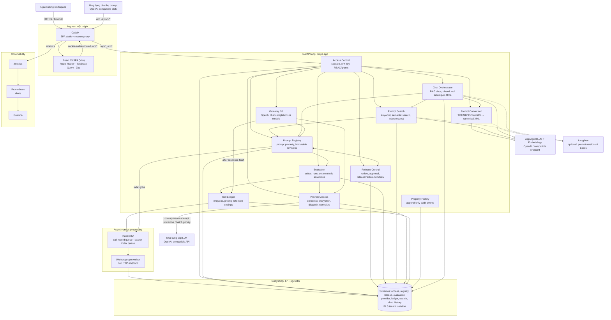
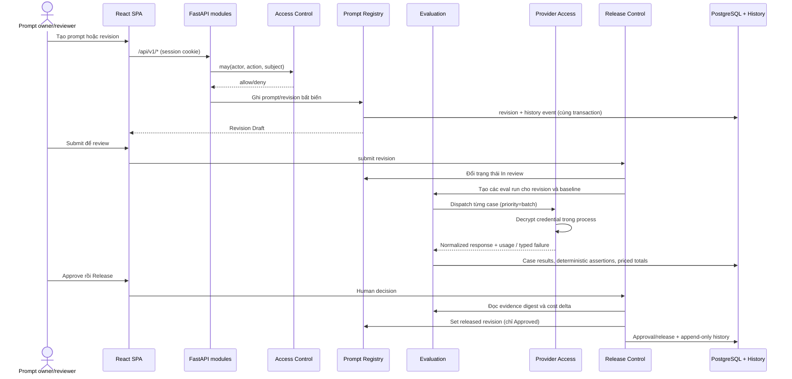
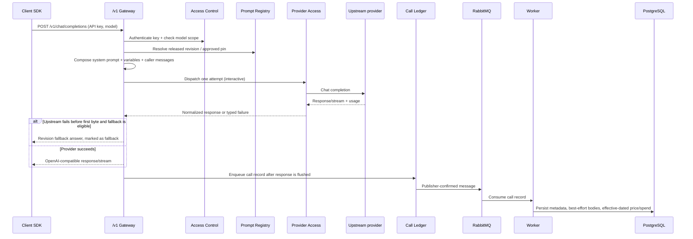
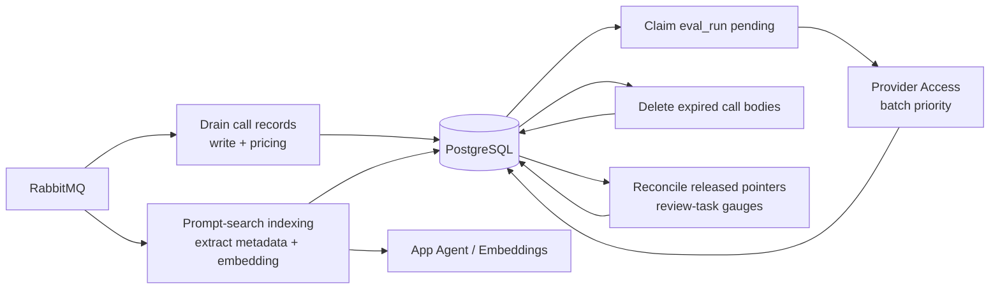
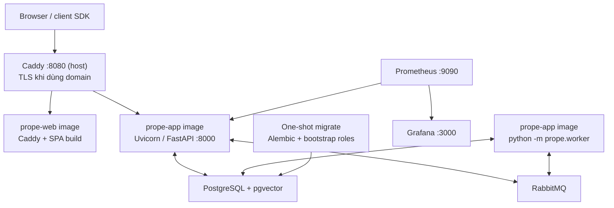

# Kiến trúc Prope

Prope là hệ thống quản trị vòng đời prompt cho nhiều workspace: đăng ký và phiên bản hoá prompt, đánh giá, phê duyệt/phát hành có người chịu trách nhiệm, tìm kiếm, và gateway tương thích OpenAI cho ứng dụng tiêu thụ prompt đã phát hành.

Runtime gồm SPA React, một FastAPI application, một worker không có HTTP surface, PostgreSQL có RLS/pgvector và RabbitMQ. Caddy cung cấp một origin duy nhất cho SPA và API. App Agent dùng cấu hình LLM của ứng dụng; provider do workspace cấu hình chỉ được gọi qua `provider-access`.

## Sơ đồ thành phần và luồng dữ liệu

Mũi tên liền thể hiện call/luồng dữ liệu runtime. Mũi tên nét đứt là tích hợp quan sát tuỳ chọn. Các module management gọi `access-control` để xác thực và phân quyền; không module nào tự giữ một bản sao policy.

## Luồng nghiệp vụ chính

### 1. Vòng đời prompt có kiểm soát con người

`Evaluation` so sánh candidate và released baseline bằng cùng suite. Assertion pass/fail là deterministic; agent chỉ có thể dự thảo dataset/đề xuất, không quyết định release.

### 2. Lưu lượng production qua gateway

Nếu publisher confirm thất bại, app dùng direct PostgreSQL fallback: metadata vẫn được ưu tiên bền vững, body có thể bị bỏ và được đếm metric. Gateway không chặn lưu lượng theo spend ceiling; ceiling chỉ từ chối bắt đầu evaluation.

### 3. Công việc nền

Worker được giám sát để chạy lại các job: drain ledger, search indexing, retention, queue depth, eval claim/sweeper và release reconciliation/gauges. Worker không expose HTTP hoặc metrics endpoint; Prometheus scrape `app:8000/metrics`.

## Dữ liệu, bảo mật và ranh giới trách nhiệm

| Vùng dữ liệu | Chủ sở hữu | Luồng/chính sách đáng chú ý |
|---|---|---|
| `access` | Access Control | Workspace, user/session, role/grant, API key; session cho người, API key cho consumer. |
| `registry`, `release`, `history` | Registry, Release Control, Property History | Revision và audit event là append-only; chỉ revision Approved mới được release. |
| `evaluation` | Evaluation | Suite/case/run/result; evidence và cost delta phục vụ quyết định người duyệt. |
| `provider` | Provider Access | Credential mã hoá AES-GCM với KEK ngoài DB; secret không trả về API hoặc log. |
| `ledger` | Call Ledger | Call metadata, body best-effort retention, bảng giá effective-dated và tổng spend. |
| `search` | Prompt Search | Chỉ mục metadata/embedding, cache embedding và vector pgvector. |
| `chat` | Chat Orchestrator | Conversation/message/pending action theo workspace **và** actor. |

Mọi schema nghiệp vụ mang tenant isolation bằng PostgreSQL RLS; runtime `app` và `worker` dùng role ứng dụng, còn migration chạy một lần bằng credential có quyền cao hơn. `property-history` không có API riêng: các module chủ thể kiểm tra quyền rồi đọc activity của chính chúng.

## Triển khai

`docker-compose.yml` điều phối: `postgres`, `rabbitmq`, one-shot `migrate`, `app`, `worker`, `prometheus`, `grafana`, `caddy`. Development overlay thay Caddy bằng Vite dev server có HMR nhưng vẫn proxy cùng các prefix `/api`, `/v1`, `/metrics`, `/healthz`, `/readyz`, nên browser giữ một origin.

## Mã nguồn làm căn cứ

- Composition/runtime: `src/prope/app.py`, `src/prope/worker.py`, `docker-compose.yml`, `Caddyfile`.
- Bounded contexts: `src/prope/{access_control,prompt_registry,release_control,evaluation,provider_access,gateway,call_ledger,prompt_search,prompt_conversion,chat_orchestrator,property_history}`.
- Schema/RLS/migration: `alembic/versions/0001` đến `0021`.
- Frontend: `src/prope-fe/main.tsx`, `App.tsx`, `lib/apiClient.ts` và các feature theo domain.
