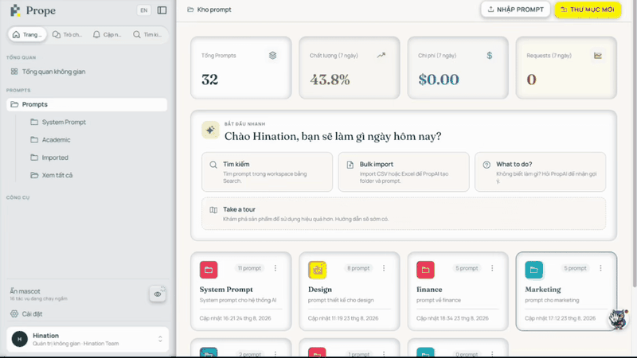

# Prope

Prope quản trị toàn bộ vòng đời prompt theo workspace: registry và revision bất biến, evaluation, review/release có human-in-the-loop, tìm kiếm semantic và gateway tương thích OpenAI cho prompt đã phát hành.

Sơ đồ thành phần và luồng dữ liệu: [docs/architecture.md](docs/architecture.md).

🌐 **Live:** [https://prope.site](https://prope.site) — health: [/healthz](https://prope.site/healthz) · readiness: [/readyz](https://prope.site/readyz)

🎬 Video demo 5 phút (kịch bản, luồng sản phẩm): [docs/video-demo.md](docs/video-demo.md)

## Giao diện

**Landing**


**New/Edit prompt**



## Nhóm thực hiện

| Thành viên | Mã học vụ | GitHub | Vai trò |
|---|---|---|---|
| Lê Đăng Tấn | 2A202601916 | [@RealDangTanVin](https://github.com/RealDangTanVin) | Team Lead · Product / UX / FE |
| Nguyễn Quang Sơn | 2A202601956 | [@VinQuangSon](https://github.com/VinQuangSon) · [@RealQuangSon](https://github.com/RealQuangSon) | BA / FE |
| Ngô Hữu Nghĩa | 2A202601924 | [@ngohuunghia-123](https://github.com/ngohuunghia-123) | AI Eval / BE / Tester |
| Lương Minh Quân | 2A202601308 | [@SyaroCh845](https://github.com/SyaroCh845) | AI Engineer / BE |

## Công nghệ

- React 19, Vite, TypeScript, Tailwind, TanStack Query và Zod.
- FastAPI trên Python 3.13.
- PostgreSQL 17 + pgvector, Alembic và RLS tenant isolation.
- RabbitMQ + worker không có HTTP endpoint.
- Prometheus, Grafana, structured JSON logs; Langfuse là tuỳ chọn.

## Kiến trúc

[](docs/architecture.md)
*SPA React + FastAPI chia bounded contexts, PostgreSQL 17 (RLS/pgvector), RabbitMQ worker, Caddy single origin; provider-access là egress LLM duy nhất. Luồng dữ liệu chi tiết: [docs/architecture.md](docs/architecture.md).*

## Cấu trúc thư mục

```text
prope/
├── README.md
├── docs/                        # ADR, kiến trúc, evaluation, journal, worklog
├── src/
│   ├── prope/                   # Backend FastAPI — bounded contexts
│   │   ├── access_control/      # Session, RBAC/grant, API key, workspace
│   │   ├── prompt_registry/     # Prompt, folder, revision bất biến
│   │   ├── release_control/     # Review, approve, release/restore/withdraw
│   │   ├── evaluation/          # Suite, dataset, eval run, case result
│   │   ├── provider_access/     # Credential mã hoá, egress LLM duy nhất
│   │   ├── gateway/             # /v1 OpenAI-compatible
│   │   ├── call_ledger/         # Call record, bảng giá, spend ceiling
│   │   ├── prompt_search/       # Keyword + semantic search, indexing
│   │   ├── prompt_conversion/   # TXT/MD/JSON/YAML → canonical XML
│   │   ├── chat_orchestrator/   # RAG docs, tool catalogue, HITL actions
│   │   ├── prompt_ingestion/    # Import prompt hàng loạt
│   │   ├── prompt_improvement/ prompt_readiness/ prompt_observation/
│   │   ├── agent_run/ property_history/
│   │   ├── app.py               # FastAPI assembly
│   │   └── worker.py            # Worker không có HTTP endpoint
│   └── prope-fe/                # React 19 SPA (Vite + TypeScript + Tailwind)
├── tests/                       # pytest: unit, integration, security, e2e, load (testcontainers)
├── alembic/                     # Migration + RLS policy + DB constraint
├── eval/                        # Retrieval evaluation + evidence
├── sdk/python/                  # SDK tiêu thụ gateway
├── seed/  playgrounds/          # Seed thư viện prompt mẫu
├── deploy/                      # Runbook deploy production
├── .github/workflows/           # CI
├── Dockerfile  Dockerfile.web
└── docker-compose.yml  docker-compose.dev.yml  Caddyfile
```

## Yêu cầu

Cách chạy khuyến nghị là Docker Compose:

- Docker Desktop có Docker Compose v2.
- Các cổng 8080, 3000, 9090 đang rảnh.
- API key OpenAI-compatible nếu muốn dùng conversion, semantic search/indexing, chat orchestrator hoặc AI dataset drafting.

Để chạy quality gates ngoài container cần Python >=3.13,<3.14, uv, Node 22 và pnpm 11.

## Khởi động nhanh (Windows PowerShell)

1. Tạo cấu hình local:

   ```powershell
   Copy-Item .env.example .env
   ```

2. Mở file .env và thay password placeholder. Tạo KEK 32 byte base64:

   ```powershell
   $bytes = [byte[]]::new(32)
   [Security.Cryptography.RandomNumberGenerator]::Fill($bytes)
   [Convert]::ToBase64String($bytes)
   ```

   Điền kết quả vào PROPE_KEK_V1. Để dùng đầy đủ App Agent, điền thêm APP_OPENAI_API_KEY. Không commit .env, password, KEK hay API key.

3. Build và chạy stack:

   ```powershell
   docker compose up --build -d
   docker compose ps
   ```

4. Truy cập:

   | Surface | URL |
   |---|---|
   | SPA + management API | http://localhost:8080 |
   | Liveness | http://localhost:8080/healthz |
   | Readiness (PostgreSQL + KEK) | http://localhost:8080/readyz |
   | Prometheus | http://localhost:9090 |
   | Grafana | http://localhost:3000 |

Tạo account/workspace đầu tiên tại trang đăng ký. Swagger/OpenAPI không được public trong runtime.

## Biến môi trường

File .env.example là template chuẩn cho local development. Khi dùng Compose, các URL database và broker được dựng riêng cho migrate, app và worker; không tự thêm URL trực tiếp vào .env.

### Bắt buộc

| Biến | Mục đích |
|---|---|
| POSTGRES_PASSWORD | Password PostgreSQL superuser, chỉ dành cho migration. |
| PROPE_MIGRATE_PASSWORD | Password role migration. |
| PROPE_APP_PASSWORD | Password role runtime prope_app cho app/worker. |
| PROPE_REPORT_PASSWORD | Password role report; không cấp cho app/worker. |
| RABBITMQ_DEFAULT_USER, RABBITMQ_DEFAULT_PASS | Tài khoản RabbitMQ. |
| GRAFANA_ADMIN_PASSWORD | Mật khẩu Grafana administrator. |
| PROPE_KEK_V1 | KEK base64 để mã hoá credential provider; thiếu KEK làm readiness trả 503. |

### App Agent và embedding

| Biến | Default | Mục đích |
|---|---|---|
| APP_OPENAI_BASE_URL | https://api.openai.com/v1 | Base URL OpenAI-compatible cho App Agent. |
| APP_OPENAI_API_KEY | rỗng | API key dùng cho tính năng AI ứng dụng. |
| APP_AGENT_MODEL | gpt-4o-mini | Chat model cho conversion, extraction, chat và dataset drafting. |
| APP_EMBEDDING_MODEL | text-embedding-3-small | Embedding model mặc định. |
| EMBEDDING_BASE_URL, EMBEDDING_API_KEY, EMBEDDING_MODEL | rỗng | Override riêng cho embedding; rỗng thì fallback về APP_OPENAI và APP_EMBEDDING_MODEL. |
| EMBEDDING_DIMENSIONS | 1536 | Phải tương thích cột pgvector hiện có. |
| EMBEDDING_TIMEOUT_SECONDS | 30 | Timeout mỗi attempt embedding. |
| SEARCH_DUPLICATE_THRESHOLD | 0.9 | Ngưỡng cảnh báo prompt gần trùng. |

Đổi EMBEDDING_MODEL làm index cũ stale; cần re-index thay vì trộn vector từ hai model.

### Tùy chọn

| Biến | Mục đích |
|---|---|
| LANGFUSE_PUBLIC_KEY, LANGFUSE_SECRET_KEY, LANGFUSE_HOST | Trace và managed prompt versions. Có thể để rỗng: ứng dụng fallback về instruction tích hợp, Prometheus và JSON logs. |
| APP_AGENT_MAX_OUTPUT_TOKENS | Giới hạn output conversion. |
| APP_AGENT_PRICE_INPUT_PER_MTOK, APP_AGENT_PRICE_OUTPUT_PER_MTOK | Giá USD trên một triệu token cho metric chi phí; đổi cùng APP_AGENT_MODEL. |
| PROMPT_CONVERSION_DSPY_PROGRAM | Artifact DSPy conversion; chỉ thêm demonstrations, không thay instruction production. |
| PROMPT_SEARCH_MAX_OUTPUT_TOKENS, PROMPT_SEARCH_BODY_CHAR_LIMIT, PROMPT_SEARCH_DSPY_PROGRAM | Giới hạn/artifact cho extraction index. |
| PROPE_RETENTION_CHUNK_SIZE | Batch xoá call body hết hạn. |
| PROMPT_SEARCH_* còn lại | Tuning ranker; chỉ đổi khi có evaluation evidence. |
| APP_ENV | Đặt development ở local. |
| ADMIN_SESSION_TOKEN | Chỉ cho development, không thay cơ chế login. |
| PROPE_COOKIE_SECURE | Default true; chỉ false cho local/bare-IP HTTP. Compose local đã đặt đúng giá trị. |
| PROPE_SITE_ADDRESS | Production đặt domain để Caddy tự cấp TLS. |

## Câu lệnh thường dùng

### Docker Compose

```powershell
# Log các process chính
docker compose logs -f app worker caddy

# Health qua ingress
Invoke-RestMethod http://localhost:8080/healthz
Invoke-RestMethod http://localhost:8080/readyz

# Dừng nhưng giữ dữ liệu local
docker compose down

# Reset toàn bộ dữ liệu local (phá huỷ PostgreSQL/RabbitMQ/Grafana volumes)
docker compose down -v
```

### Development với HMR

Dev overlay chạy Uvicorn reload, worker watcher và Vite HMR; Vite vẫn proxy API cùng origin ở port 8080.

```powershell
docker compose -f docker-compose.yml -f docker-compose.dev.yml up -d --build
docker compose -f docker-compose.yml -f docker-compose.dev.yml logs -f app worker web
docker compose -f docker-compose.yml -f docker-compose.dev.yml down
```

### Quality gates

```powershell
# Backend
uv sync --frozen --group dev
uv run pytest -q
uv run ruff check src/ tests/ alembic/

# Frontend
Set-Location src/prope-fe
corepack enable
pnpm install --frozen-lockfile
pnpm tsc
pnpm lint
pnpm build
```

Makefile cũng có make test, make lint và make check. Trên Windows, dùng lệnh uv run ở trên nếu không có GNU Make/Git Bash.

Load test cần PostgreSQL và RabbitMQ đang chạy, mất khoảng 12 phút:

```powershell
$env:PROPE_RUN_LOAD = "1"
uv run pytest -m load -q
Remove-Item Env:PROPE_RUN_LOAD
```

## API chính

Base URL: `https://prope.site` (local: `http://localhost:8080`). Hai kiểu auth:

- `/api/v1/*` — session cookie HttpOnly (cấp sau `/api/v1/auth/login`).
- `/v1/*` — `Authorization: Bearer prope_<key_id>_<secret>` (consumer API key).

Lỗi trả về dạng `{ "code": ..., ... }` với `code` là mã máy để client tự dịch (ADR-0053). Subject mà actor không có quyền xem được trả **not-found**, không phải forbidden. Danh sách đầy đủ ~130 route theo từng module nằm ở `src/prope/*/api.py`; dưới đây là các nhóm chính.

### Auth & workspace

| Method | Path | Mô tả |
|---|---|---|
| POST | `/api/v1/auth/register` | Tạo account (chưa tạo workspace — ADR-0056) |
| POST | `/api/v1/auth/login` / `logout` | Đăng nhập / đăng xuất, cookie phiên server-side |
| GET | `/api/v1/auth/session` | Phiên hiện tại |
| GET | `/api/v1/auth/workspaces` | Workspace của phiên |
| POST | `/api/v1/auth/workspaces/{workspace_id}/enter` | Vào workspace (thu hồi phiên cũ, cấp phiên mới) |
| POST | `/api/v1/auth/invites/redeem` | Nhận lời mời |
| POST | `/api/v1/workspaces` | Tạo workspace |
| POST | `/api/v1/workspaces/{id}/invites` | Mời thành viên |
| GET/POST | `/api/v1/workspaces/{id}/keys` | Liệt kê / cấp consumer API key |
| PUT | `/api/v1/workspaces/{id}/members/{user_id}/roles` | Đổi vai trò thành viên |
| POST | `/api/v1/workspaces/{id}/members/{user_id}/approve` · `/reject` | Duyệt / từ chối thành viên |

### Registry — prompt & revision

| Method | Path | Mô tả |
|---|---|---|
| GET/POST | `/api/v1/prompts` | Danh sách / tạo prompt |
| GET/PATCH | `/api/v1/prompts/{prompt_id}` | Chi tiết / sửa metadata |
| POST | `/api/v1/prompts/{prompt_id}/revisions` | Tạo revision mới (bất biến) |
| GET | `/api/v1/revisions/{version_id}` | Nội dung một revision |
| GET | `/api/v1/prompts/{prompt_id}/diff` | Diff giữa hai revision |
| GET | `/api/v1/prompts/{prompt_id}/activity` | Audit trail |
| GET/POST | `/api/v1/folders`, GET/PATCH/DELETE `/api/v1/folders/{slug}` | Quản lý folder |
| POST | `/api/v1/prompts/{prompt_id}/retire` | Cho prompt nghỉ |

### Review & release (human-in-the-loop)

| Method | Path | Mô tả |
|---|---|---|
| GET | `/api/v1/prompts/{prompt_id}/revisions/{version_id}/review` | Xem hồ sơ review |
| POST | `/api/v1/prompts/{prompt_id}/revisions/{version_id}/submit` | Gửi review |
| POST | `/api/v1/prompts/{prompt_id}/revisions/{version_id}/request-changes` | Từ chối kèm lý do |
| POST | `/api/v1/prompts/{prompt_id}/revisions/{version_id}/approve` | Duyệt revision |
| GET/POST | `/api/v1/prompts/{prompt_id}/releases` | Lịch sử / thực hiện release (chỉ nhận revision Approved) |
| POST | `/api/v1/prompts/{prompt_id}/releases/withdraw` | Rút release |
| POST | `/api/v1/prompts/{prompt_id}/releases/break-glass` | Release khẩn cấp (được đếm, có follow-up 24h) |
| GET/POST | `/api/v1/review-tasks` | Hàng review chờ xử lý / đóng task |

### Evaluation

| Method | Path | Mô tả |
|---|---|---|
| GET/POST | `/api/v1/prompts/{prompt_id}/eval-suites` | Suite của prompt |
| PUT | `/api/v1/eval-suites/{suite_id}` | Sửa suite |
| GET/POST/PUT/DELETE | `/api/v1/datasets...` | Dataset eval |
| GET/POST | `/api/v1/prompts/{prompt_id}/eval-runs` | Lịch sử / chạy suite cho revision |
| GET | `/api/v1/eval-runs/{run_id}/cases` | Kết quả từng case |
| GET | `/api/v1/eval-runs/{run_id}/cases/{case_result_id}/trace` | Trace một case |
| GET | `/api/v1/prompts/{prompt_id}/comparison` | So candidate vs baseline |

### Provider & gateway

| Method | Path | Mô tả |
|---|---|---|
| GET/POST | `/api/v1/providers` | Cấu hình provider; credential không bao giờ trả về |
| POST | `/api/v1/providers/{provider_id}/credential` | Thay credential (mã hoá KEK) |
| POST | `/api/v1/providers/{provider_id}/verify` | Kiểm tra credential |
| GET | `/api/v1/providers/{provider_id}/models` | Model khả dụng |
| POST | `/v1/chat/completions` | Gateway OpenAI-compatible — chỉ phục vụ revision Approved + Released |
| GET | `/v1/models` | Model = `namespace/prompt-name` |

### Search & observability

| Method | Path | Mô tả |
|---|---|---|
| GET | `/api/v1/prompts/search` | Keyword + semantic search |
| POST | `/api/v1/prompts/search/similar` | Near-duplicate detection |
| POST | `/api/v1/prompts/{prompt_id}/index` | Yêu cầu index (chạy nền qua queue) |
| GET | `/api/v1/prompts/{prompt_id}/call-records` | Log & trace mọi call qua gateway |
| PUT | `/api/v1/prompts/{prompt_id}/call-records/{call_id}/annotation` | Ghi chú call |
| GET | `/api/v1/prompts/{prompt_id}/usage` | Thống kê sử dụng |
| PUT | `/api/v1/workspaces/{id}/retention` | Chính sách retention call body |
| PUT | `/api/v1/workspaces/{id}/spend-ceiling` | Trần chi tiêu evaluation |

### Tính năng AI (App Agent)

| Method | Path | Mô tả |
|---|---|---|
| POST | `/api/v1/prompt-conversions` | TXT/MD/JSON/YAML → canonical XML |
| POST | `/api/v1/chat/messages` · `/stream` | Chat orchestrator (RAG docs, HITL) / SSE stream |
| POST | `/api/v1/prompts/{prompt_id}/revisions/{version_id}/case-drafts` | AI dự thảo dataset eval |
| GET | `/api/v1/prompts/{prompt_id}/readiness` | Điểm sẵn sàng trước publish |
| GET/POST | `/api/v1/observations` | Quan sát vận hành → đề xuất |

### Hệ thống

| Method | Path | Mô tả |
|---|---|---|
| GET | `/healthz` | Liveness |
| GET | `/readyz` | Readiness (PostgreSQL + KEK) |
| GET | `/metrics` | Prometheus (nội bộ, không public) |

## Smoke test API

Tạo account đầu tiên. **Đăng ký chỉ tạo tài khoản, không tạo workspace** (ADR-0056) —
phiên đăng nhập trả về có `workspace_id` là `null`, và bước tiếp theo là tạo workspace:

```powershell
$payload = @{
  display_name = "Local Admin"
  email = "admin@example.test"
  password = "a-long-local-test-password"
} | ConvertTo-Json

Invoke-RestMethod `
  -Method Post `
  -Uri "http://localhost:8080/api/v1/auth/register" `
  -ContentType "application/json" `
  -Body $payload `
  -SessionVariable propeSession

Invoke-RestMethod `
  -Method Post `
  -Uri "http://localhost:8080/api/v1/workspaces" `
  -ContentType "application/json" `
  -Body (@{ name = "Local" } | ConvertTo-Json) `
  -WebSession $propeSession
```

Tạo workspace **không** tự động đưa phiên vào đó: `POST /api/v1/auth/workspaces/{id}/enter`
là route duy nhất sau đăng nhập thay đổi cookie phiên, vì nó xoá phiên hiện tại và cấp
phiên mới trong workspace đích. Trên giao diện, màn hình chọn workspace làm việc này.

Gateway chỉ phục vụ prompt đã Approved và Released. Sau khi cấu hình provider, tạo revision, evaluation và release, gọi bằng consumer API key:

```powershell
$gatewayPayload = @{
  model = "namespace/prompt-name"
  messages = @(@{ role = "user"; content = "Xin chào" })
} | ConvertTo-Json -Depth 4

Invoke-RestMethod `
  -Method Post `
  -Uri "http://localhost:8080/v1/chat/completions" `
  -Headers @{ Authorization = "Bearer prope_<key_id>_<secret>" } `
  -ContentType "application/json" `
  -Body $gatewayPayload
```

Provider credential không đi trong gateway request: chúng được lưu mã hoá và chỉ provider-access decrypt trong process.

## Seed thư viện prompt

Seed import file từ playgrounds/prompts thành prompt/revision Draft; không tự approve hoặc release. Sau khi tạo account, chạy dry-run:

```powershell
docker compose run --rm `
  -v "${PWD}/seed:/work/seed" `
  -v "${PWD}/playgrounds:/work/playgrounds" `
  -w /work `
  app `
  python seed/seed_prompts.py `
  --email "admin@example.test" `
  --password "a-long-local-test-password" `
  --dry-run
```

Bỏ --dry-run khi đã kiểm tra đúng workspace. Xem tuỳ chọn tại [seed/README.md](seed/README.md).

## Production

Production dùng image đã publish, không build trên VM. Quy trình deploy, biến production và rollback: [deploy/README.md](deploy/README.md). Giữ file .env production ở quyền hạn chế, ngoài Git/CI; chỉ expose Caddy công khai, không public Prometheus/Grafana.
