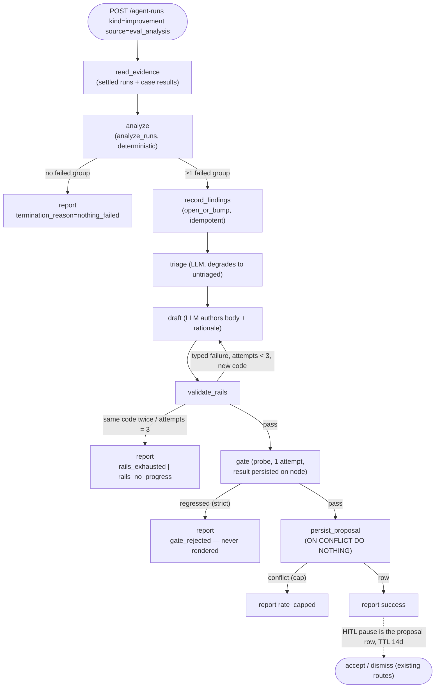

# 01 — Orchestration

Stack: **custom** (FastAPI app + Prope worker, Postgres with RLS, agent-run plan nodes). Shape:
workflow. Step list from `00-shape.md` D1, verbatim. This chapter decides state, graph, and
termination for the eval-analysis improvement run.

## Decisions

| # | Decision | Value |
|---|---|---|
| D1 | State schema | The `agent_run` row is the run header; each step is a **plan node** (`improvement_detector`, `improvement_triage`, + new `improvement_draft`, `improvement_gate`) with `status`, `detail` JSONB, and a typed `ImprovementRunState` in the executor: `{revision_ref, failed_groups[], findings_opened[], triage_target, candidate_body, rails_report, gate_result, proposal_id, termination_reason}`. Declared once in `prompt_improvement/domain.py`; no free-form bag |
| D2 | Merge rules | Only one field is multi-writer: finding bump counts — merged in the DB by `open_or_bump_finding`'s `ON CONFLICT DO UPDATE` (occurrence bump, last_seen refresh). Everything else is written by exactly one step. The single-active-run lock (`pg_advisory_xact_lock` in `agent_run/repository.py:319`) prevents two runs writing the same prompt concurrently |
| D3 | Graph | Drawn below. One conditional edge: `validate_rails` → `draft` (redraft, ≤2) or → `gate`. One discard edge: `gate` regressed → `report` with `termination_reason="gate_rejected"` (proposal never rendered) |
| D4 | Persistence | Postgres is the checkpointer: every node transition commits with its `detail`. The gate result is persisted **on the node before** `persist_proposal`, so a crash between gate and proposal does not re-pay the gate on resume |
| D5 | Resume semantics | A resumed/re-executed run skips nodes already `completed` (read node status, not memory). Steps are idempotent: findings/proposal by DB conflict rules; `read_evidence`/`analyze`/`triage` are reads or degrade-cleanly; `draft` pays only itself; `gate` is skipped if its node already carries a result |
| D6 | Termination set | Four stops, all wired: **success** (proposal opened, or explicit `nothing_failed` when no group failed); **max iterations** (redraft cap); **budget cap** (per-run currency + wall-clock, D8); **no-progress** (identical rails failure code on two consecutive drafts stops the redraft loop early) |
| D7 | Max iterations | **3 total draft attempts** (1 initial + 2 redrafts) — a self-correction loop, so 3 |
| D8 | Budget caps | In code, per run: (a) draft spend — `max_output_tokens` bounded (default 6000, env-tunable like the drafter) on Prope's meter; (b) gate probe spend — probe only the suites named in the findings (the attached-suite intersection), case total hard-capped at `IMPROVEMENT_PROBE_CASE_CAP` (default 40) on the workspace's meter; (c) wall clock — the agent-run timeout the worker already enforces. Breach ⇒ abort, keep findings, report partial with the reason |
| D9 | No-progress detector | Rails failure carries a typed code; **the same code twice consecutively ⇒ stop**, report `termination_reason="rails_no_progress"` |
| D10 | Retry placement | Per step. Transport retries live in the shared app-agent client (3, jittered — existing). Redraft is a *self-correction* loop, not a transport retry, and each redraft carries the validation error as feedback. `gate`: **1 attempt, never retried** |
| D11 | Partial failure | Complete-what-succeeded, per shape D4: findings always open; a run that ends without a proposal records why (`drafter_unavailable` / `rails_exhausted` / `rails_no_progress` / `gate_rejected` / `rate_capped`) — five distinguishable non-error outcomes |
| D12 | Pause and resume | The HITL pause is **data, not a held thread**: the run *completes* when the proposal opens; the pause is the `improvement.proposal` row waiting for accept/dismiss with a 14-day TTL (existing expiry sweeper is the pause timeout). Deploys cannot lose it |
| D13 | Reflection | Off. No reflect step; the rails feedback loop is the only self-correction, and it is bounded and measured (`rails_rejected_total{rail}`) |
| D14 | — | n/a (D13 off) |
| D15 | Event volume | ≤10 nodes + ≤3 draft attempts per run; node `detail` bounded (evidence lines ≤400 chars per the schema CHECK; gate delta is the existing compact `as_delta()` JSON) |
| D16 | Concurrency | Fan-out exists only inside `gate` (cases in parallel) — bounded by the probe's case concurrency (5, matching `PER_RUN_CONCURRENCY`); across runs, the single-active-run advisory lock bounds a workspace to one improvement run per prompt |

## D3 — the graph

## Failure modes → what catches them

| Failure | Catch |
|---|---|
| Noisy tool / looping drafter | No-progress detector (same rails code twice) + 3-attempt cap + token cap |
| Wrong draft poisoning later steps | `validate_rails` verifies the observation satisfies the subgoal (canonical, variables intact, bounded) — not merely that the model returned 200 |
| Lost run on deploy | Node-per-step persistence in Postgres; HITL pause is a row, not a thread |
| Double side effect on resume | Idempotent writes + gate result persisted pre-proposal + advisory lock |
| Retry storm | Client-side jittered retries only; gate untriable; circuit breaker (reliability-cost chapter) |
| Silent cap exit | `termination_reason` is a first-class field on the run, counted per reason (observability chapter) |

## Build handoff rows (Prope-specific)

| Must exist in code | Proven by |
|---|---|
| `ImprovementRunState` typed object with the named fields | unit test on state transitions |
| New plan nodes `improvement_draft`, `improvement_gate` with per-node detail | agent-run plan test |
| Gate node persists result before proposal write | crash-injection test: kill between gate and proposal, resume, assert no second probe |
| `termination_reason` recorded for all seven outcomes | run-outcome test table |
| Probe case cap + draft token cap as configuration | config surface test |
| Single-active-run lock covers the new source | concurrent-start test |

## Readiness checks

| ID | Sev | Assertion | Status |
|---|---|---|---|
| O1 | blocker | Four termination conditions wired, each exercised by a test | design; tests in slice 8 |
| O2 | blocker | Per-run budget cap aborts, enforced in code | design: caps in D8 |
| O3 | blocker | Durable checkpoint per step; killed process resumes at the right step | node persistence (D4/D5); test in slice 8 |
| O4 | blocker | Every paying/writing step idempotent under retry | DB conflict rules + gate-unretryable |
| O5 | high | Shared state fields have merge rules | one multi-writer, DB-merged |
| O6 | high | Per-step retries bounded, jittered | client retries + bounded redraft |
| O7 | high | Termination reason recorded and counted | node + metric |
| O8 | high | Pause survives restart | pause is a DB row with TTL |
| O9 | med | Graph drawing matches code | mermaid above ↔ executor nodes |
| O10 | med | Caps are configuration, not constants | env-tunable, slice 5 |
| O11 | med | Fan-out bounded | probe concurrency 5; 1 run/prompt |
| O12 | low | Checkpoint size measured | node detail bounded by schema |
