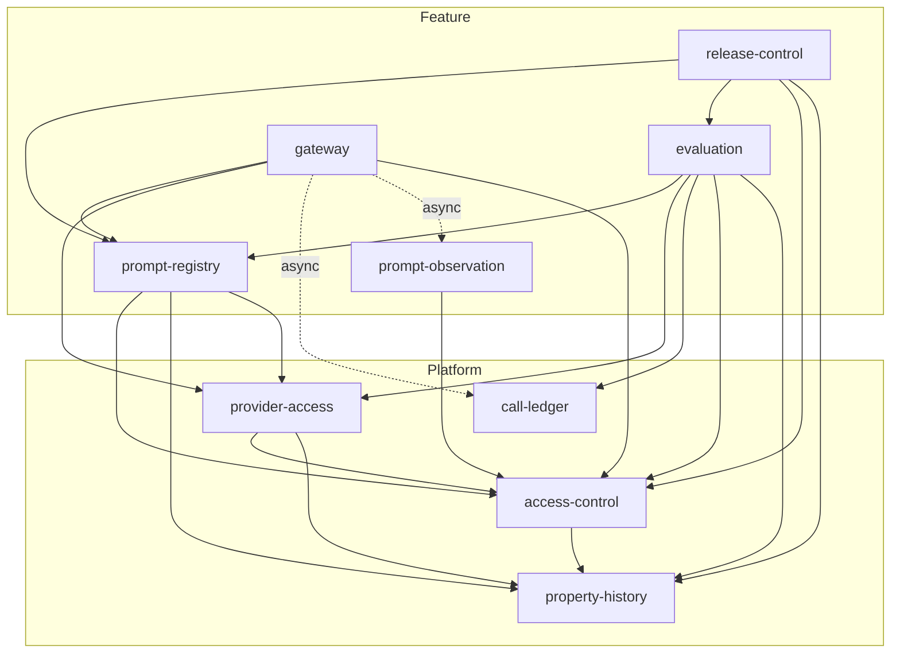

# Prope — Module map

**Date**: 2026-08-08
**Source**: `00_context.md` (scope, constraints, glossary)

Eight modules across eight bounded contexts. The decomposition follows where the vocabulary
changes, not where the deployment artefacts split — there is no "frontend" or "backend" module,
because neither owns a journey.

> **⚠️ This file is behind `docs/modules/`, and knowingly so as of 2026-08-18.** Four modules have lock
> files and no row here: `prompt-conversion`, `prompt-search`, `chat-orchestrator` (added during the
> build, never mapped) and `prompt-observation` (added 2026-08-18 by ADR-0060, and mapped below because
> its edges are the point of the decision that created it). `docs/architecture/interfaces.md` already
> records the same gap from the diagram's side — *"module_map.md still lists eight modules… the map is
> the artifact that is behind"*. The sentence above therefore describes the MVP decomposition as it was
> argued, not the module set as it stands, and reconciling the two is a step-2 pass nobody has run.
> Adding `prompt-observation` here without the other three is a deliberate partial fix: its forbidden
> edges are load-bearing and had nowhere else to live.

## Modules

| module_id        | title            | one_liner                                                                        | context          | kind     | size | deps_out                                                                        | deps_in                                                                       |
| ---------------- | ---------------- | -------------------------------------------------------------------------------- | ---------------- | -------- | ---- | ------------------------------------------------------------------------------- | ----------------------------------------------------------------------------- |
| prompt-registry  | Prompt Registry  | Registers prompt properties and their immutable revisions, with search and diff. | Prompt Registry  | FEATURE  | L    | access-control, property-history, provider-access                               | release-control, evaluation, gateway                                          |
| evaluation       | Evaluation       | Runs a prompt's fixed eval suite and reports per-case pass/fail and cost delta.  | Evaluation       | FEATURE  | M    | prompt-registry, provider-access, call-ledger, access-control, property-history | release-control                                                               |
| release-control  | Release Control  | Carries a revision from submitted to approved to released, and restores it.      | Release Control  | FEATURE  | M    | prompt-registry, evaluation, access-control, property-history                   | none                                                                          |
| gateway          | Gateway          | OpenAI-compatible endpoint resolving a model name to the released revision.      | Gateway          | FEATURE  | M    | prompt-registry, provider-access, call-ledger, access-control                   | none                                                                          |
| provider-access  | Provider Access  | Holds workspace provider credentials and makes the upstream model call.          | Provider Access  | PLATFORM | M    | access-control, property-history                                                | gateway, evaluation, prompt-registry                                          |
| call-ledger      | Call Ledger      | Stores call records off the response path and prices token usage.                | Call Ledger      | PLATFORM | M    | none                                                                            | gateway, evaluation                                                           |
| access-control   | Access Control   | Authenticates actors and answers every may-this-actor-do-this question.          | Access           | PLATFORM | S    | property-history                                                                | prompt-registry, release-control, gateway, provider-access, evaluation        |
| property-history | Property History | Append-only event log of every state change, written through one writer.         | Property History | PLATFORM | S    | none                                                                            | prompt-registry, release-control, provider-access, access-control, evaluation |
| prompt-observation | Prompt Observation | Holds the prompts a workspace is running that Prope does not manage, discovered from traffic. | Prompt Observation | FEATURE | S | access-control | gateway (async, write-only) |
| prompt-readiness | Prompt Readiness | Measures whether a candidate revision is ready for the job its Usage Profile says it does. | Prompt Readiness | FEATURE | M | prompt-registry, evaluation, provider-access, access-control, call-ledger (write side) | none |
| prompt-improvement | Prompt Improvement | Measures whether a RELEASED revision is still doing the job it was approved to do, from call metadata and a scheduled re-probe. | Prompt Improvement | FEATURE | M | prompt-readiness, prompt-registry, evaluation, provider-access, access-control, property-history | none |

## Bounded contexts

| Context          | Modules          | Ubiquitous language                                                                                      | Data it solely owns                                                            |
| ---------------- | ---------------- | -------------------------------------------------------------------------------------------------------- | ------------------------------------------------------------------------------ |
| Prompt Registry  | prompt-registry  | prompt property, revision, version ID, model name, fallback answer, owner, tag, access level, diff       | `prompt_property` (including the released-revision pointer, A-041), `revision` |
| Evaluation       | evaluation       | eval case, named eval suite, suite version, output modality, deterministic assertion, eval run, baseline, pass/fail, cost delta | `eval_suite`, `eval_case`, `eval_run`, `case_result`         |
| Release Control  | release-control  | submit, review task, approval, acknowledgement, release, restore, withdraw, break-glass, trusted revision, In use | `approval`, `release`, `review_task`                                           |
| Gateway          | gateway          | model name, resolution, pin, outcome, fallback, streaming, consumer, variable, stale resolution          | none durable — the 30 s resolution cache (A-031, A-080) is a bounded in-process LRU, rebuildable |
| Provider Access  | provider-access  | provider configuration, credential, adapter, verification probe, upstream model, generation parameters, usage object, dispatch, priority class, admission | `provider_config`, `credential` (envelope-encrypted, its own table so no config read path can return it — ADR-0014), `model_catalogue` (no prices — A-091) |
| Call Ledger      | call-ledger      | call record, usage row, price table, effective date, cost, token count, retention, unpriced, unknown usage, spend ceiling | `call_record`, `call_body` (write-then-delete, no reader — ADR-0018), `price_table` (append-only, effective-dated), `workspace_spend`, `spend_ceiling` |
| Access           | access-control   | workspace, member, role, permission, action, private by default, grant access, grant level, **namespace grant**, consumer key, key scope, **namespace scope**, session | `workspace` (A-109), `user`, `session` (A-108), `workspace_member`, `role_binding`, `role_permission` (the matrix, as rows — A-115), `prompt_grant` (with a level — A-112), `namespace_grant` (the same level at folder scope, on a **value** not an FK — A-157, ADR-0061), `api_key` (A-081, hashed — ADR-0021; carries both scope arrays and the observe pair) |
| Property History | property-history | history event, actor, action, target, target type, prompt scope, sequence, details payload, reason, append-only | `history_event` (append-only by database privilege — ADR-0025), `history_action_registry` (the closed 30-name vocabulary and its per-action detail keys — A-120, A-124) |
| Prompt Observation | prompt-observation | observation, sighting, fingerprint, drift, inferred variable slot, proposal, adopt, dismiss, ungoverned, observation namespace | `observation` (one row per fingerprint per workspace), `sighting` (the occurrences, bounded — only a sighting that CHANGED the body keeps a copy) |
| Prompt Readiness | prompt-readiness | usage profile, audience, untrusted input, acts, sensitivity, lethal trifecta, finding, rule id, severity, dismissal, readiness card, frozen report, probe, probe case, refused, leaked, evidence line | `dismissal` (per prompt and rule, carried across revisions), `report` (the reviewer's frozen copy, written once), `probe_run` + `probe_case_result` (a probe is **not** an eval run — ADR-0067), `lane_b_cache` (fingerprinted, derived) |
| Prompt Improvement | prompt-improvement | detector, anomaly, window, finding, occurrence count, proposal, remedy kind, remedy family, candidate body, eval gate, gate delta, evidence card, sweep, re-probe, cadence, profile drift | `finding` (deduped on prompt+detector, an open one bumps a count), `proposal` (**at most one open per prompt, by partial unique index**), `sweep` (one per workspace per pass; **never deleted**, because `is_first_sweep` is computed from it), `schedule` (per workspace, opt-in, disabled by default) |

**Two words are shared and had to be assigned.** *Grant access* belongs to Access Control, which owns
the grant record and the check; the registry only displays an **access level**. *Usage object* belongs
to Provider Access, which receives it from the upstream provider; the Call Ledger's word for the
priced result is a **usage row**. The glossary in `00_context.md` stays the authority for both.

**The namespace is now the unit of authorisation, and it belongs to Prompt Registry** (ADR-0061,
added 2026-08-18). This is the one piece of vocabulary two contexts genuinely share, so it is assigned
rather than left ambiguous. The registry owns the **namespace** — it is the first half of A-021's model
name, `prompt_property.namespace` is where it lives, and `registry.folder` is the *label* somebody may
optionally hang on it. Access Control owns the **namespace grant**, the way it already owns the prompt
grant while the registry only displays an access level. And a **folder** is never the thing authority
attaches to: grants name the namespace *value*, so a folder with no row can be granted and deleting a
folder revokes nothing (A-157). Calling the permission "folder access" in the UI is fine; calling it
that in the schema is the mistake this paragraph exists to prevent.

**A third word was assigned 2026-08-18, and getting it wrong is what the new context exists to prevent.**
An **observation** is not a *revision* and not a *prompt property*. It has no owner, no access level, no
status, and no version ID — every one of which is a word Prompt Registry owns and a thing a
non-negotiable applies to. That is precisely why ADR-0060 refused to put these tables in `registry`:
they would have been the first rows in that schema that BR-01's private-by-default rule cannot reach.
The vocabulary boundary is the module boundary here, exactly as the decomposition rule says it should
be. An observation stops being an observation the moment a person adopts it, and from that moment it is
a revision, in the registry, with the registry's words and the registry's rules.

## INVEST

| module_id        | Independent | Negotiable | Valuable | Estimable | Small  | Testable | Pass        |
| ---------------- | ----------- | ---------- | -------- | --------- | ------ | -------- | ----------- |
| prompt-registry  | yes         | yes        | yes      | yes       | **no** | yes      | with caveat |
| evaluation       | **no**      | yes        | yes      | yes       | yes    | yes      | with caveat |
| release-control  | **no**      | yes        | yes      | yes       | yes    | yes      | with caveat |
| gateway          | yes         | yes        | yes      | **no**    | yes    | yes      | with caveat |
| provider-access  | yes         | yes        | yes      | yes       | yes    | yes      | yes         |
| call-ledger      | yes         | yes        | yes      | **no**    | yes    | yes      | with caveat |
| access-control   | yes         | **no**     | yes      | yes       | yes    | yes      | with caveat |
| property-history | yes         | yes        | yes      | yes       | yes    | yes      | yes         |
| prompt-observation | yes       | yes        | yes      | **no**    | yes    | yes      | with caveat |
| prompt-readiness | yes       | yes        | yes      | **no**    | yes    | yes      | with caveat |
| prompt-improvement | yes     | yes        | yes      | **no**    | yes    | **no**   | with caveat |

**prompt-improvement — Independent: no. Reusable: no.** *Added 2026-08-20 (ADR-0068).* Six outbound
dependencies, more than any other module, and it is **the only module in the map that depends on another
FEATURE module**: it takes `prompt-readiness`'s probe runner rather than writing a second dispatch loop,
because a second one would be a second definition of *"refused 11 of 12"* and would make the very
comparison the scheduled re-probe exists for meaningless. That edge also cost `prompt-readiness` its leaf
status, which its own `seams.py` docstring now records rather than leaving a sentence standing that has
stopped being true.

**Reusable: no**, and it is the first module in this map to score that. Everything it does is specific to
*this* product being on the request path: the detectors read `ledger.call_record`'s exact outcome
vocabulary, the gate reads `evaluation`'s suites, the profile drift reads a stamp ADR-0067 invented. There
is nothing here to lift out.

**Its forbidden edges.** `release-control` is forbidden **in both directions**, inherited from ADR-0067
and costing even less to keep: nothing here wants to be at submit time, and a post-publish finding has
LESS standing to gate a future decision than a pre-publish one. `call-ledger` is forbidden on the read
side specifically — the metadata window comes through prompt-registry's seam (INT-043), because a direct
edge would be the flat cross-prompt reader ADR-0055 rejected by name and would disclose that private
prompts exist through a door nobody classified as a read. `gateway` is forbidden because nothing here
touches the response path. `prompt-observation` is forbidden because it is adjacent and not the same
question — observation asks *what did we miss*, this asks *how is what we manage holding up* — and the
first draft of this design proposed borrowing its store for traffic samples, which the scheduled re-probe
removed the need for.

**Unlike its sibling, it IS a `writing_module`**, the sixth. ADR-0067 kept readiness dismissals out of
property-history on A-102's precedent and that reasoning is not reversed: a dismissed lint is not a state
change on a prompt property. A **proposal disposition** is a different object — a person's decision about
a machine-authored change to a prompt that is serving production traffic — and *who said yes* is exactly
what ADR-0025's append-only privilege model exists to keep.

**prompt-readiness — Independent: no.** *Added 2026-08-20 (ADR-0067).* Five outbound dependencies, the
most of any module in the map, and every one is a read except the call-ledger pair. That is the shape the
module is: it assembles a judgement out of facts four other modules already hold — the body and its
profile from prompt-registry, coverage and the assertion compiler from evaluation, the dispatch from
provider-access, the ceiling from call-ledger — and owns only the judgement itself. **Testable: no**, for
call-ledger's and gateway's reason: Lane C cannot be exercised end to end without a provider, so the probe
path is tested against a stubbed dispatch and the ceiling refusal is tested for real.

**Its forbidden edges are where the design lives.** `release-control` is forbidden **in both directions**,
which is unusual — most forbidden edges are one-way. Nothing here is an input to a release decision and
nothing here may be consulted by one, because a readiness card that release-control read would be a gate
wearing a panel's clothes. That ban is what forced the freeze onto the card READ rather than onto a submit
hook (ADR-0067). `property-history` is not forbidden but is deliberately absent: a dismissed finding is not
a state change on a prompt property, so it is recorded in this module's own table on prompt-observation's
A-102 precedent, and the tenth `writing_module` never has to exist. `call-ledger` is present on the write
side only — the ceiling check and the usage enqueue — and the read side is forbidden, because this module
never asks what happened in production. That is `prompt-improvement`'s question, and it is the module still
waiting on OQ-154.

**evaluation — Independent: no.** *Corrected 2026-08-09 (step 6, pass 1).* This row read all-`yes`.
Evaluation has **five** declared dependencies — prompt-registry, provider-access and access-control
hard, call-ledger soft, property-history hard — which is more than any other module in the build, and
release-control is scored `Independent: no` on four. One criterion cannot mean two things in one table.
The caveat is the same shape as release-control's and is not a defect: evaluation is a composition
module by design, it owns its own tables and its own decisions, and nothing about the score suggests a
different boundary. It is recorded so the table can be read as evidence rather than as decoration.

**prompt-registry — Small: no.** It is the one `L`. Step 8 asks whether it splits into `S + M`; the
obvious cut is a property record module plus a revision store, and it is the wrong cut: a revision
store nobody can browse delivers no value on its own, so the split fails INVEST harder than the size
does. The size is real and the mitigation is sequencing, not a boundary — build property + revision +
history read first, then search and filter, then the diff view.

**release-control — Independent: no.** The review screen composes the diff (prompt-registry), the
pass/fail and cost delta (evaluation), and its own decision record. It is buildable against stubs of
both, but it cannot be *demonstrated* before them. This is a sequencing fact, not a boundary defect —
approval and release are their own vocabulary and their own data, and folding them into either
neighbour would put a decision record inside a module that has no business owning one.

**gateway — Estimable: no.** Two unknowns sit inside it. The p95 50 ms budget is an agent-decided
placeholder (A-031, and the constraints table says so plainly), and streaming wire-compatibility with
accumulate-after-close logging (A-038) is the part of this build most likely to be wrong on the first
try. Both narrow once OQ-012's latency number is set.
*Amended 2026-08-08 after locking gateway* — the score stands, and the second unknown is now named
rather than gestured at: the sharp edge is the **first-byte boundary**, because the fallback is
reachable on one side of it and not the other (ADR-0013). The first unknown is unchanged and is
entirely OQ-012's to close; the instrumented span exists either way, so the first load test replaces a
placeholder rather than starting an argument about how to measure it.

**call-ledger — Estimable: no.** OQ-013 is open and `business-analysis.md` §11 rates it Critical:
retention duration, who may read a body, PII/redaction, residency. A-040 is a placeholder. The schema
and the deletion job can be built now; the policy they enforce cannot be estimated yet.
*Amended 2026-08-08 after locking call-ledger* — the score stands and three of the four sub-questions
stopped affecting the estimate. Retention duration is a per-workspace setting with the job already
built (A-106); "who may read a body" concerns a reader that does not exist and is not being built
(ADR-0018); residency is a deployment question step 4 owns. What remains is **PII and redaction**,
because a redaction pass before storage is real build work that either exists or does not, and nobody
can say which yet.

**provider-access — all `yes`, and it briefly was not.** Locking it raised one estimability unknown:
whether a second, non-OpenAI-shaped adapter was on the MVP's critical path (OQ-016). The user closed
it the same day — OpenAI-compatible is the whole MVP, and a second adapter is post-MVP work they will
build themselves (A-094). The module's provider surface is therefore one HTTP client against a
configurable base URL. The encryption scheme is decided (ADR-0014); only the key's *store* is step 4's,
and that is true of every module's deployment concerns.

**property-history — all `yes`, and locking it confirmed rather than tested that.** Every field was
already determined by the seven locks before it, which is what an eighth module with no dependencies
should look like. Two things are worth recording anyway. Its `Independent: yes` is not a free property —
it is what A-044 bought by giving this module no standalone UI and therefore no permission check, and it
is the single fact that lets access-control depend on it without a cycle. And its `Estimable: yes`
depends on a decision the map never named: the append is a function call in the caller's transaction,
because that is the only arrangement under which five other locks' "synchronous, same transaction"
sentences are true (ADR-0023). Under an HTTP service or a queue this module would be neither small nor
estimable, and "no release without a trail" would quietly become "almost always a trail".

**prompt-observation — Estimable: no.** *Added 2026-08-18.* One outbound dependency, one bounded
context, two tables, and it still cannot be estimated — because the unknown is not in the module. Two
things sit outside it. **OQ-147** decides whether the data it exists to hold may exist at all, and its
lock is `ready_for_build: false` on that and nothing else; a module that may turn out to be
unbuildable-as-specified is not estimable however small it is. And **A-154's fingerprint is a heuristic
over other people's code** — the normalisation rule cannot be validated in advance, because the input is
production prompts nobody has seen, which is the same fact that makes the module worth building. The
score is honest rather than pessimistic: the `Valuable: yes` is the strongest in the table, because this
is the only module that delivers anything before a customer has migrated a single prompt.

**access-control — Negotiable: no, Estimable: no.** Four constraint rows are marked non-negotiable
here: edit/review/release separated, private by default, only Approved revisions resolve, credentials
never readable back. What is *not* settled is the full role matrix (OQ-006, A-007 is a working set),
which is why the estimate is soft even though the rules are hard.
*Amended 2026-08-08 after locking access-control* — **both scores stand, and the reason for Estimable
`no` has changed.** The role matrix is no longer the soft part: it is a `role_permission` table over a
closed action vocabulary (A-115), rendered at an endpoint so the running matrix can be checked against
the signed-off one, which makes OQ-006's answer a seed rather than a release. What is unestimated is a
different half of the same question — **whether the pilot must authenticate against the group's identity
provider**. A-108 assumes local email and password with server-side sessions, and if that is wrong the
work is an OIDC integration nobody has scoped. Removing a role after bindings exist stays the expensive
case, which is why A-007 records exactly four. Locking also settled the harder unknown the map never
named: this module must authorise subjects it is forbidden to read, resolved by having callers pass the
subject's attributes (ADR-0020).
*Amended 2026-08-09 during the step-4 global baseline* — **`Estimable` becomes `yes`.** The reason
recorded above was the identity-provider question, and the user answered it: local email and password
with server-side sessions, A-108 confirmed and promoted to `human`, recorded in ADR-0029. There is no
unscoped OIDC integration hiding in this module. `Negotiable` stays **no** — the four non-negotiable
constraint rows are untouched, and ADR-0035 adds a fifth mechanism to that set by making BR-01's
private-by-default rule a row-level security policy rather than a `WHERE` clause. What remains open in
OQ-006 is data classification and retention, which is policy about what the pilot may hold, not work
inside this module.

## Dependency seams

What crosses each edge:

- **release-control → prompt-registry** — reads a revision's status, body, and diff; issues **three**
commands, which prompt-registry executes against its own tables: `set_released_revision` (A-041),
`clear_released_revision` for a withdrawal (A-069, ADR-0009), and `set_revision_status` for the
Draft / In review / Approved transitions (A-064, ADR-0008). No other module may issue any of them.
*Amended 2026-08-08 while locking release-control* — the last two are new. `set_revision_status`
replaces a direct write: prompt-registry's lock originally said release-control writes `revision.status`
itself, which put a second writer on the value BR-03's released-pointer constraint reads.
- **release-control → evaluation** — reads the latest run summary for a candidate revision: per-case
pass/fail and the cost delta against the released revision. Read-only, pull-based (A-042).
- **release-control → access-control** — five distinct permission checks: submit, approve, release,
break-glass, withdraw (A-007, A-069). *Amended 2026-08-08* — the reviewer ≠ author check is gone. The
user overturned A-008: eligibility is a permission question and nothing else, so access-control is the
whole answer and this edge carries no second rule (ADR-0010).
- **release-control → property-history** — `revision_submitted`, `revision_approved`,
`revision_changes_requested`, `revision_released`, `revision_restored`, `revision_break_glass_released`,
`release_withdrawn`, `review_task_closed` events with actor, target version ID, and reason. The last two
added 2026-08-08 (A-069, A-073). The append shares the transaction with the decision, so there is no
release without a trail and no trail without a release.
*Amended 2026-08-08 while locking property-history* — the first six were bare verbs (`submitted`,
`approved`, `released`) and every other writing module uses `<target_type>_<past participle>` into the
same column of the same table; renamed (A-120). The "shares the transaction" clause is the one this map
repeats five times, and it turns out to constrain the architecture rather than describe it: it is only
implementable if the history writer is an in-process library on the caller's own connection, which is
now written down rather than assumed (ADR-0023).
- **evaluation → prompt-registry** — reads the candidate revision and the currently released revision:
body, provider, model, generation parameters.
- **evaluation → provider-access** — one dispatch per eval case, with the revision's binding. Eval
dispatch never serves a fallback; an upstream failure is a run error (A-034). *Amended 2026-08-08* —
the call carries `priority: batch`, and batch is what gets shed when the shared credential hits the
provider's rate limit (ADR-0016). A-063's global bound still applies and sits above this: it caps what
one workspace's runs may ask for, while admission decides who wins when both classes ask at once.
Evaluation's retry policy (A-053) is executed by its own loop, because a dispatch is exactly one
attempt (A-088).
- **evaluation → call-ledger** — submits each run's usage for pricing against the effective-dated
price table, and reads back the two priced totals it subtracts. Also asks
`check_spend_ceiling(workspace_id)` before the first dispatch of a run — a yes/no, never a figure
(A-029, A-056). Usage only: eval outputs live on `case_result`, not in `call_body` (A-055).
*Amended 2026-08-08 while locking call-ledger* — `get_run_totals` returns the count of **unpriced** and
**unknown-usage** rows alongside the totals, because a delta computed over a partly unpriced run is not
a delta and the review screen has to be able to say so (A-101, ADR-0019). The ceiling check **fails
open** and counts the failure (A-104): it guards an optional, off-by-default feature, and blocking a
reviewer over a billing lookup is the worse trade. Eval usage lands in the same `call_record` table as
gateway traffic under `source = eval`, so one spend total covers both — which matters because gateway
traffic is usually what pushes a workspace toward the ceiling that then refuses a run (A-098).
- **evaluation → access-control** — *added 2026-08-08 while locking evaluation.* BR-10 makes editing
the eval contract a different permission from editing prompt text, and A-004 presupposes the suite is a
separate object with its own permission. Runs and stored outputs are also permission-filtered on the
same private-by-default rule as the registry. `criticality: hard` — fails closed. No cycle:
access-control depends only on property-history.
- **evaluation → property-history** — *added 2026-08-08 while locking evaluation.* A-014 makes every
state change an event, and A-004 requires a suite edit to be a *recorded* action — a suite edit changes
the yardstick every later comparison is measured with, so an unrecorded one makes past approvals
unexplainable. Events: `eval_suite_updated`, `eval_run_started`, `eval_run_completed`,
`eval_run_interrupted`. No cycle: property-history depends on nothing.
- **gateway → prompt-registry** — the hot read: model name → released revision binding, or a pinned
`name@<n>`. Also `list_released(workspace_id)`, which backs `GET /v1/models` (A-082, added 2026-08-08
while locking gateway). Cached 30 s in-process. *Amended 2026-08-08* — the cache is **not** invalidated
on release, restore, or withdrawal; it **expires**. No invalidation mechanism exists in a system where
this edge runs one way, so a pointer change lands within one TTL and the
release UI says so (ADR-0012, A-080, superseding A-031's invalidation clause). *Amended 2026-08-09
(step 6, pass 1)* — this sentence also said "and A-012 rules out a broker". **ADR-0028 added one during
step 4.** Fanout invalidation over it was then reconsidered on merit and rejected again, on four
independent grounds recorded in ADR-0012's second amendment: it would fire only on withdrawal, the
rarest action in the product; it would make `app` a broker consumer for the first time; it would not
close the window under a restart or A-130's split; and it contradicts four separate TTL-or-nothing
answers. The conclusion is unchanged and now rests on an argument rather than on an absence. A withdrawn prompt has
no released revision and resolves to model-not-found — never to the previous revision and never to the
fallback answer (A-022, A-069, ADR-0009). "Model name unknown" and "model name known, nothing released"
must be separable in the resolve-miss metric, or a withdrawal is invisible in the one number that shows
its blast radius; the label now exists on both sides of this edge.
- **gateway → provider-access** — dispatch with the revision's provider, model, and parameters. The
credential never leaves Provider Access, in either direction (A-025). *Amended 2026-08-08 while
locking provider-access* — three things now cross this edge that the original line did not name. The
call carries a **deadline and a priority class** (`interactive`), because one credential serves both
live traffic and eval runs and a five-suite submit must not starve a checkout page (ADR-0016). What
comes back is either an **OpenAI-shaped** response plus a usage object (ADR-0015) or a **typed
failure** carrying `fallback_eligible`, `retryable`, and `origin` — the gateway reads the first and
does not re-derive it, because that judgement needs provider knowledge and a second copy of it would
drift invisibly against evaluation's (ADR-0017). Exactly one attempt is made; A-084's no-retry rule is
enforced by the gateway not calling again (A-088).
- **gateway ⇢ call-ledger** — *asynchronous, enqueue-only*. Metadata durable with local spill, bodies
best-effort with a drop counter (A-037). This edge must never block a response. *Amended 2026-08-08
while locking call-ledger* — the record carries a **caller-generated `call_id`** and the writer upserts
on it (A-099). Without it, replaying the spill after a crash inserts records twice, which
double-counts the workspace's spend and moves every later cost delta: durability without idempotency
trades lost data for wrong data. `enqueue()` never raises and never applies backpressure, and that
property is contract-tested rather than assumed, because it is what the gateway's p95 rests on.
- **gateway → access-control** — authenticates the consumer's API key and confirms the key may resolve
that model name. *Amended 2026-08-08 while locking gateway* — the `api_key` table was named by this
seam but owned by nobody, which is how a second writer appears later. It belongs to **access-control**,
and a key is **default-deny**: it carries the explicit list of model names it may resolve (A-081). The
gateway holds no key material. A scope refusal returns the same not-found shape as an unknown name, so
a leaked key cannot enumerate the registry.
*Amended 2026-08-08 while locking access-control* — **neither call is cached, on either side of this
edge** (A-114, ADR-0022). That is a deliberate divergence from the gateway's own 30-second resolution
cache sitting next to it, and the reason is what a stale answer costs: a stale released pointer serves
a previously approved revision one TTL late, while a stale permission serves a *revoked* key. The two
calls together carry a stated budget of p95 < 5 ms inside the gateway's 50 ms, measured in the
gateway's own load test rather than in isolation, because a module with no cache and no measured budget
is how a 50 ms path quietly becomes an 80 ms one.
- **gateway ⇢ prompt-observation** — *added 2026-08-18 (ADR-0059, ADR-0060).* **Asynchronous,
write-only, post-flush**, and reached on one path only: a request whose model name produced
`UNKNOWN_MODEL` on a key carrying `observe_provider_config_id`. What crosses is the caller's message
set, the upstream model they named, and the call id (INT-034). It carries INT-018's two contract-tested
properties for INT-018's reason — never raises, never blocks — and it does **not** carry INT-018's
mechanism: the write is direct, not published, because ADR-0028 declares one queue and a lost
observation costs a counter where a lost call record costs money (A-155). **There is no read direction
and there will not be one.** The gateway never consults the inventory, which is the same rule that keeps
it out of call-ledger in the read direction, for the same reason: a read edge is the first step toward
doing during a call what is supposed to happen after it.
- **prompt-observation → access-control** — its **only** outbound edge. One `may()` per route, at this
module's own edge, on `prompt.read` against a subject carrying the observation's **namespace**.
*Amended 2026-08-18, the same day it was written* — it first read `prompt.create` against the
workspace, a borrowing taken because an observation had no container and minting an action is a
cross-module `CHECK` change OQ-079 had declined. ADR-0061 supplied the container, so the borrowing is
gone and this module needs no permission rule of its own: an observation is seen by whoever would see a
prompt in the same folder. That also removed an inversion nobody had named — `prompt.create` is what a
Prompt Owner holds on day one, and it was being made to grant the widest read in the product. No cycle:
access-control depends only on property-history.
- **prompt-registry → access-control** — read, edit, and grant checks; private-by-default enforcement.
*Amended 2026-08-18 (ADR-0061)* — the check now carries the prompt's **namespace** as a third
caller-supplied attribute beside `owner_id` and `access_level`, and `visible_subject_filter` gains a
`namespaces` mode this module ORs into its own `WHERE`. It extends ADR-0020 without strain for exactly
one reason: `registry.folder` is flat, so a namespace is one string with no ancestors and there is
nothing for the oracle to read. Under a folder tree the attribute would be a path whose meaning lives
in rows access-control may not see, and the edge below would stop being unnecessary and start being
needed — which is why flat is now a constraint rather than a shape.
*Amended 2026-08-08 while locking access-control* — two things now cross this edge that the original
line did not name. The check carries the **prompt's own `owner_id` and `access_level` as parameters**,
because access-control may not read `prompt_property` and the reverse edge is forbidden (ADR-0020);
the registry has already read the row, so it passes what it has. And list, search, and the repository
filter use `visible_subject_filter(actor, "prompt")` rather than one `may()` per row (A-118) — without
a set form, this module's own promise that "permission filtering lives in the repository layer, not in
handlers" cannot be kept without a cross-module join it also forbids. Granting access is a **command**:
the registry renders the screen, access-control writes the `prompt_grant` row and its event, in the
ADR-0008 pattern.
- **prompt-registry → property-history** — `property_created`, `revision_created`, `owner_changed`,
`access_level_changed`, `retired` events. *Corrected 2026-08-08 while locking access-control* — this
line previously read `access_granted`, which disagreed with prompt-registry's own lock file and, more
importantly, named an event about `prompt_grant`, a table this module does not own. `access_granted`
and `access_revoked` are a pair and both belong to access-control. `access_level_changed` is the
registry's own event, about a field on `prompt_property`.
*Amended 2026-08-08 while locking property-history* — each append also stamps `scope_prompt_id` (A-119).
That column is what makes `GET /prompts/{id}/activity` a single indexed read: the events a user expects
on that screen are written by four modules against six target types, and neither the registry nor
property-history may join across the tables that hold them. It is denormalised on purpose — free where
it is known, impossible where it is needed.
- **prompt-registry → provider-access** — *added 2026-08-08 while locking prompt-registry.* A revision
carries a provider configuration and an upstream model (A-024), so creating one needs the model
catalogue to validate against and to populate the editor's picker. Read-only, `criticality: soft` —
the catalogue caches 5 minutes and a revision may reuse the previous revision's binding. No cycle:
provider-access depends only on access-control and property-history.
- **provider-access → access-control** — who may add, edit, or rotate a provider configuration.
*Amended 2026-08-08* — credential-bearing actions are their own permission, not a sub-case of
workspace administration and not implied by prompt-edit rights (A-007, OQ-006). Dispatch itself is
**not** re-checked here: authorisation happened at the calling module's own edge, and a second check
on the hot path is a second thing that can disagree with the first.
- **provider-access → property-history** — `provider_configured`, `provider_updated`,
`provider_disabled`, `credential_rotated` events with the credential redacted. *Amended 2026-08-08* —
the middle two are new. A configuration that is disabled or repointed at a different base URL changes
what production calls, and an unrecorded change of that kind makes a later incident unexplainable. The
event records that a rotation happened and by whom, never what changed (A-025, A-046).
- **access-control → property-history** — `role_assigned`, `member_added`, `access_revoked` events.
*Amended 2026-08-08 while locking access-control* — the full list is `workspace_created`,
`member_added`, `member_removed`, `role_assigned`, `role_revoked`, `access_granted`, `access_revoked`,
`api_key_created`, `api_key_revoked`, appended in the same transaction as the change. `access_granted`
moved here from prompt-registry's list, because this module owns `prompt_grant` and a module may not
publish an event about a table it does not own. Sign-ins and failed sign-ins are deliberately **not**
events: property history is the log of state changes, and authentication traffic belongs in metrics and
logs — the same argument that keeps a gateway call out of it (A-039, A-044).
- **access-control → (nothing else)** — this is its only outbound edge, and the `may()` signature is
what keeps it that way. Every other module's permission question would naturally require reading that
module's tables; ADR-0020 pushes those attributes into the call instead, so the forbidden edges below
are unnecessary rather than merely prohibited.
- **property-history → (nothing)** — *added 2026-08-08 while locking property-history.* The only module
in Prope with an empty outbound list AND an empty inbound-call list of its own: five modules call
`append()`, three of those call `read(scope)`, and it calls nobody. That is not tidiness, it is the
mechanism — A-044 gave it no screen so it would need no permission check, so it would not depend on
access-control, which must write its grants through here. Every other property in its lock is downstream
of that one trade. The 30 event names it now owns are the reconciliation of five separate lists that had
drifted into two naming schemes (A-120, ADR-0024), and the table is append-only by database privilege
rather than by intention (ADR-0025) — the same call BR-03 got, for the same reason.

### Cycles, and how they are broken

Three would-be cycles exist in the obvious drawing. All three are broken here, none needs your ruling.

1. **prompt-registry ↔ release-control.** Both want the released pointer. Broken by making it a field
  on the prompt property that only release-control may write (A-041), so the gateway's hot path is one
   read instead of two and the edge runs one way.
2. **evaluation ↔ release-control.** Submitting a revision should trigger a run; a finished run should
  update the review screen. Broken by removing the second half: evaluation never calls release-control,
   and release-control reads run state when it renders (A-042).
3. **access-control ↔ property-history.** History wants to check who may read it; access-control wants
  to log grants. Broken by giving property-history no standalone UI — the owning module checks
   permission and then asks for events (A-044).

### Forbidden edges

- **call-ledger → anything.** It is a sink. A ledger that calls back into a feature module is how
"log after" turns into "log during", and the p95 budget dies quietly. *Amended 2026-08-08 while
locking call-ledger* — this edge has a consequence the original line did not draw out. With no edge to
**access-control**, call-ledger cannot check a permission, so it must expose nothing that needs one —
which means the stored bodies have **no read path in the MVP** (ADR-0018, A-105). That is consistent
with `00_context.md#scope`, which already puts trace explorers and dashboards out of scope, and it
leaves OQ-013's access half as a question about a surface that does not exist yet rather than a
retrofit. Its own configuration changes are audited by an append-only effective-dated price table and
`updated_by` columns instead of by property-history, because a spend ceiling is not a state change on
a prompt property and A-014 does not reach it (A-102).
- **prompt-observation → call-ledger.** *Added 2026-08-18 (ADR-0060).* The nearest miss in the build and
the one most worth writing down, because it is a good idea. An observation and a call record describe
the same request, so a join would answer *"what are we spending on prompts Prope does not manage"* — the
single most persuasive number this feature can produce — in one query. **Refused.** call-ledger is a
sink, and ADR-0055 opened exactly one read path into it: per prompt, behind `prompt.read`, mounted by
prompt-registry. An observation carries no `prompt_id` and therefore cannot pass that check, so the join
needs a **second** read path with a **different** rule, which is how the first exception stops being an
exception. The number is composed by the SPA from two reads, or it waits. Note the asymmetry that makes
this survivable: the *write* direction already crosses — an observed call writes a `call_record` under
`source = observed` — because that arrow runs gateway → call-ledger and has always been allowed.
- **prompt-observation → prompt-registry.** *Added 2026-08-18 (ADR-0060).* It would be one function call
to create the prompt and its Draft revision, and the argument against it is one sentence: adopting an
ungoverned prompt must be an act a person performs **in the registry**, with the registry's own events,
not a side effect this module produces on their behalf. The proposal route returns a body; a human posts
it. prompt-conversion settled the same question the same way — *"conversion never saves a revision"* —
and the payoff is identical: non-negotiable #1 needs no new enforcement anywhere, because there is no
path from observed text to a released prompt that does not run through a person creating one and another
approving it.
- **prompt-observation → property-history.** *Added 2026-08-18.* Tempting and wrong. A-014 makes every
state change **on a prompt property** an event, and an observation is not one; A-102 already settled the
identical case for call-ledger's own configuration. Adoption and dismissal are columns on the row. The
cost of getting this wrong is specific: one history event per discovered prompt would put thousands of
machine-generated rows into the one table whose entire value is that every row in it is a decision
somebody made.
- **anything → credential.** Provider Access returns responses and usage, never the secret
(`00_context.md` constraints; A-025). *Amended 2026-08-08 while locking provider-access* — A-025's own
statement violated this edge in writing: it said credentials were "decryptable by the gateway and the
eval runner", wording that predates A-043 and contradicts both of those modules' locks. Corrected.
**provider-access is the only module that decrypts anything**, into a 60-second in-memory cache and
nowhere else (A-092, ADR-0014).
- **evaluation → gateway.** A-027 says the eval runner uses the same *resolution* path; it does not use
the gateway module. Upstream dispatch lives in provider-access so a batch path never depends on a
latency-critical one (A-043).
- **access-control → anything but property-history.** *Added 2026-08-08 while locking access-control.*
It is the oracle six modules consult; an edge back into any of them is a cycle, and the tempting one is
concrete — deciding whether someone may edit a prompt needs the prompt's owner, which lives in
prompt-registry. ADR-0020 removes the need rather than forbidding the symptom: the caller passes the
subject's `owner_id` and `access_level`, because it has already read the row. The same reasoning
forbids the FK: `prompt_grant.prompt_id` is a **value, not a foreign key**, since a constraint would
point this module's schema at prompt-registry's table. That is the mirror of the provider-access case,
where the FK ran the same way the dependency already did and was therefore free (A-096) — here it runs
against it, and prompts are never deleted anyway (ADR-0002), so it would buy nothing.
- **property-history → anything.** *Added 2026-08-08 while locking property-history.* Everything above
about access-control applies here one step further out, because this is the module access-control itself
depends on. Three edges are individually tempting and all three are refused. An edge to
**access-control**, to permission-check a history read — refused, because that is the exact cycle A-044
broke, and the read API takes an already-authorised scope instead (A-123, asserted by a route-table test
rather than a rule, since the person who mounts `/api/v1/history` will be somebody reasonable who wants
an audit screen). An edge to **prompt-registry**, to resolve a `target_id` into a title for a nicer feed
— refused; rendering belongs to the module that owns the subject and has already read the row. And an
edge to **call-ledger**, which is forbidden from both ends and has a genuinely respectable argument for
it: `00_context.md#success` measures restore time from a history event to the first call record carrying
the restored version ID. That metric is hand-run SQL at pilot review, not a product surface (A-126) —
written down because "the context file says we measure this" is otherwise a plausible case for adding
the one edge the map forbids outright. The same reasoning makes `target_id` a **value, not a foreign
key**: it would have to reference eight tables across five modules, it would run against the dependency
direction, and it would make the row recording a change deletable by the deletion it records (A-122).

