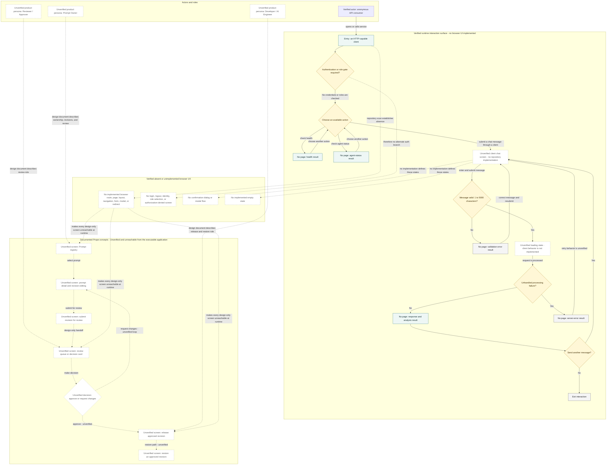

# Verified UX/UI User Flow

## Scope and reading rule

This is a reconstruction of the executable application's interaction surface, not a proposed Prope product flow. Solid branches are supported by application code or tests. Dashed branches are explicitly **Unverified** product/design concepts: they appear in product/design documents but are unreachable from the running application because no corresponding frontend, endpoint, datastore, authentication, or authorization code exists.

## Role and goal inventory

| Actor/role | Status | Verified goal or limitation |
|---|---|---|
| Anonymous API consumer | Verified | Call the public service to check health, check status, or submit a chat message. The code contains no identity or role check. |
| Prompt Owner | Unverified product persona | Product documentation says this persona should register, revise, control access to, and submit prompts for review. No implementation supports those actions. |
| Reviewer / Approver | Unverified product persona | Product documentation says this persona should inspect evidence and approve or request changes. No implementation supports it. |
| Developer / AI Engineer | Unverified product persona | Product documentation says this persona should retrieve, release, and restore approved revisions. No implementation supports it. |

## Verified interaction inventory for wireframing

| Entry/action | What the user can see or receive | Success / error / loop | UI-design status |
|---|---|---|---|
| Check service health | A JSON result with `status` and environment | Returns the status result; user can choose another action | No verified page or control |
| Check agent status | A static ready/agent JSON result | Returns the status result; user can choose another action | No verified page or control |
| Submit chat message | A response and analysis result if processing completes | Empty message is rejected with 422; unhandled processing error returns 500; a new message can be submitted | A client screen, loading affordance, error presentation, retry behavior, and success presentation are **Unverified** |

## Screen and state inventory

| Candidate screen/state | Status | Reason |
|---|---|---|
| Chat screen/form | Unverified | The API accepts a `message`, but no client source implements a page, input, button, navigation, or rendering. |
| Chat loading state | Unverified | The request is asynchronous in the service; no client state implementation exists. |
| Validation-error state | Unverified UI rendering | The service returns 422 for an empty message; how a client displays it is not defined. |
| Server-error state | Unverified UI rendering | The service converts unhandled exceptions to 500; how a client displays/retries is not defined. |
| Health/status pages | Unverified UI rendering | The service provides JSON endpoints only. |
| Login, logout, access-denied, role-selection pages | Not implemented | No identity/authentication/authorization code or UI files exist. |
| Empty state, confirmation dialog/modal, redirect | Not implemented | No frontend source defines these behaviors. |
| Prompt registry, prompt detail/editor, review queue/decision, release, restore | Unverified and unreachable | These are described by product/design documents, but are absent from the executable implementation. |

## Backend trace used only to verify visible outcomes

- `GET /health` returns `{ "status": "ok", "env": ... }`.
- `GET /api/v1/status` returns a static ready payload.
- `POST /api/v1/chat` requires a `message` of 1–5000 characters. It returns `response` and `analysis`, returns 422 when validation fails, and maps unhandled exceptions to 500.
- No state-changing operation exists: the current path does not persist a user, message, prompt, revision, review, or release.

## Evidence

- `src/main.py`
- `src/api/routes.py`
- `src/models/schemas.py`
- `tests/test_api/test_routes.py`
- `docs/codebase/STRUCTURE.md`
- `docs/codebase/ARCHITECTURE.md`
- `docs/prope_source_of_truth.md` (design/discovery-only personas and concepts)
- `DESIGN.md` (design-only workbench surface)
